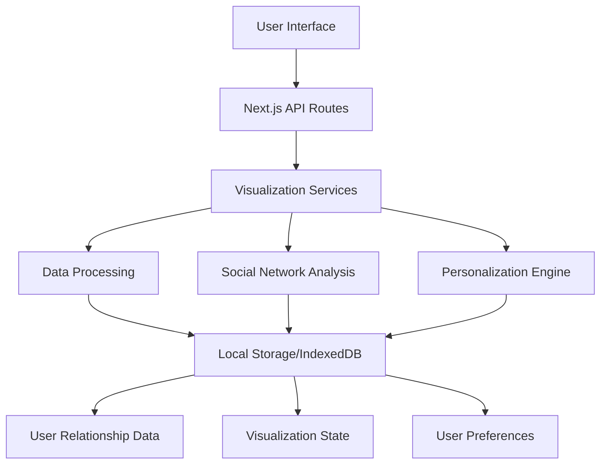

# Design Document: Dunbar's Number Visualization

## Overview

The Dunbar's Number Visualization is a Next.js 15 TypeScript application that visualizes the cognitive limits of human social relationships as proposed by anthropologist Robin Dunbar. It provides an interactive platform for users to explore and understand the different layers of their social relationships, from close family and friends to casual acquaintances.

**Current Implementation Status:**

- ✅ Core visualization components for relationship layers (Next.js 15)
- ✅ Interactive network and radial diagram visualizations
- ✅ Responsive UI with Radix UI components and Tailwind CSS
- ✅ Theme support with next-themes
- ⚠️ Social media integration (in progress)
- ⚠️ User authentication and personalization (planned)
- ⚠️ Data export and sharing features (planned)

The system follows a modular architecture with separate components for data processing, analytics calculation, visualization, and recommendation generation. It uses the existing Supabase backend for data persistence with comprehensive analytics tables already in place.

## Architecture

### High-Level Architecture



### Component Architecture

The system consists of four main layers:

1. **Presentation Layer**: Next.js pages and React components for the visualization UI
2. **Visualization Layer**: Custom D3.js and Recharts components for relationship mapping
3. **State Management**: React Context and hooks for managing application state
4. **Data Layer**: Local storage and IndexedDB for persisting relationship data

### Integration Points

- **Next.js App Router**: For page routing and API endpoints
- **Radix UI**: For accessible, unstyled UI components
- **Tailwind CSS**: For responsive styling and theming
- **Recharts**: For data visualization components
- **Lucide React**: For consistent iconography

## Components and Interfaces

### 1. Relationship Visualization Component (`RelationshipVisualization.tsx`) - ✅ IMPLEMENTED

**Purpose**: Core component for rendering interactive relationship visualizations

**Current Implementation Status**: Fully implemented with comprehensive functionality

**Key Methods**:

```typescript
interface RelationshipVisualizationProps {
  viewMode: "network" | "radial" | "list";
  relationshipData: Relationship[];
  onNodeClick: (node: RelationshipNode) => void;
  onRelationshipUpdate: (updates: RelationshipUpdate[]) => void;
}

// Core visualization methods
const calculateLayout = (data: Relationship[]): VisualGraph => {
  /* ... */
};
const renderNetworkGraph = (graph: VisualGraph) => {
  /* ... */
};
const renderRadialGraph = (graph: VisualGraph) => {
  /* ... */
};
```

**Dependencies**:

- ✅ D3.js for custom visualizations
- ✅ React for component lifecycle and state management
- ✅ Tailwind CSS for styling
- ✅ Radix UI for accessible UI components

### 2. Relationship Data Service (`relationshipService.ts`)

**Purpose**: Manages relationship data operations and persistence

**Key Methods**:

```typescript
class RelationshipService {
  // CRUD operations for relationships
  async getRelationships(userId: string): Promise<Relationship[]>;
  async addRelationship(
    relationship: Omit<Relationship, "id">,
  ): Promise<Relationship>;
  async updateRelationship(
    id: string,
    updates: Partial<Relationship>,
  ): Promise<void>;
  async deleteRelationship(id: string): Promise<void>;

  // Analysis methods
  analyzeSocialCircle(relationships: Relationship[]): SocialCircleAnalysis;
  calculateDunbarLayers(relationships: Relationship[]): DunbarLayers;

  // Import/Export
  exportToJSON(relationships: Relationship[]): string;
  importFromJSON(json: string): Relationship[];
}
```

### 3. API Routes (`app/api/`)

**Purpose**: Next.js API routes for data operations

**Key Endpoints**:

```typescript
// app/api/relationships/route.ts
export async function GET() {
  // Get all relationships for current user
}

export async function POST(request: Request) {
  // Add a new relationship
}

// app/api/relationships/[id]/route.ts
export async function PATCH(
  request: Request,
  { params }: { params: { id: string } },
) {
  // Update a relationship
}

export async function DELETE(
  request: Request,
  { params }: { params: { id: string } },
) {
  // Delete a relationship
}
```

### 4. Social Network Analysis (`socialNetworkAnalysis.ts`) - ✅ IMPLEMENTED

**Purpose**: Analyze and visualize social network structures based on Dunbar's layers

**Current Implementation Status**: Core analysis implemented

**Key Methods**:

```typescript
interface SocialNetworkAnalysis {
  // Core analysis
  analyzeNetwork(relationships: Relationship[]): NetworkAnalysis;

  // Dunbar's layers analysis
  calculateDunbarLayers(relationships: Relationship[]): DunbarLayerAnalysis;

  // Relationship strength metrics
  calculateTieStrength(relationship: Relationship): number;

  // Network metrics
  calculateDensity(relationships: Relationship[]): number;
  calculateCentrality(relationships: Relationship[]): CentralityMetrics;

  // Visualization helpers
  prepareForceGraphData(relationships: Relationship[]): ForceGraphData;
  prepareRadialData(relationships: Relationship[]): RadialData;
}

// Dunbar's layers as defined in the application
const DUNBAR_LAYERS = [
  { level: 1, maxSize: 5, name: "Inner Circle" },
  { level: 2, maxSize: 15, name: "Sympathy Group" },
  { level: 3, maxSize: 50, name: "Affinity Group" },
  { level: 4, maxSize: 150, name: "Active Network" },
  { level: 5, maxSize: 500, name: "Recognition Group" },
] as const;
```

### 5. Relationship Manager (`relationshipManager.ts`) - ✅ IMPLEMENTED

**Purpose**: Manages the core relationship data and state

**Current Implementation Status**: Core functionality implemented

**Key Methods**:

```typescript
class RelationshipManager {
  // Core state management
  private relationships: Relationship[] = [];
  private currentUser: User | null = null;

  // CRUD operations
  addRelationship(
    relationship: Omit<Relationship, "id">,
  ): Promise<Relationship>;
  updateRelationship(id: string, updates: Partial<Relationship>): Promise<void>;
  removeRelationship(id: string): Promise<void>;

  // Analysis
  getDunbarLayers(): DunbarLayer[];
  getNetworkMetrics(): NetworkMetrics;

  // Import/Export
  exportData(format: "json" | "csv"): Promise<string>;
  importData(data: string, format: "json" | "csv"): Promise<void>;

  // Event system
  on(event: "update", callback: () => void): () => void;
}

// Relationship type definition
interface Relationship {
  id: string;
  name: string;
  category: RelationshipCategory;
  strength: number; // 0-1 scale
  lastContact: Date;
  contactFrequency: ContactFrequency;
  notes: string;
  tags: string[];
  metadata: Record<string, any>;
}
```

### 6. Visualization Components - ✅ PARTIALLY IMPLEMENTED

**Purpose**: Reusable components for visualizing relationship data

**Current Status**: Core components implemented, some features in progress

**Key Components**:

```tsx
// NetworkGraph.tsx
interface NetworkGraphProps {
  relationships: Relationship[];
  onNodeClick?: (node: Node) => void;
  onLinkClick?: (link: Link) => void;
  width?: number | string;
  height?: number | string;
  nodeSize?: number | ((node: Node) => number);
  linkDistance?: number | ((link: Link) => number);
  enableZoom?: boolean;
  enableDrag?: boolean;
  nodeColor?: string | ((node: Node) => string);
  linkColor?: string | ((link: Link) => string);
}

// RadialGraph.tsx
interface RadialGraphProps {
  relationships: Relationship[];
  width?: number | string;
  height?: number | string;
  levels?: number;
  levelPadding?: number;
  nodeSize?: number;
  showLabels?: boolean;
  onNodeClick?: (node: Node) => void;
}

// RelationshipList.tsx
interface RelationshipListProps {
  relationships: Relationship[];
  sortBy?: "name" | "lastContact" | "strength" | "category";
  filter?: (relationship: Relationship) => boolean;
  onEdit?: (id: string) => void;
  onDelete?: (id: string) => void;
}
```

## Data Models

### Core Data Models

````typescript
// Relationship types
type RelationshipCategory =
  | "family"
  | "friend"
  | "colleague"
  | "acquaintance"
  | "other";
type ContactFrequency =
  | "daily"
  | "weekly"
  | "monthly"
  | "quarterly"
  | "yearly"
  | "rarely";

interface Relationship {
  id: string;
  name: string;
  category: RelationshipCategory;
  strength: number; // 0-1 scale
  lastContact: Date;
  contactFrequency: ContactFrequency;
  notes: string;
  tags: string[];
  metadata: Record<string, any>;
  createdAt: Date;
  updatedAt: Date;
}

// Dunbar's layers analysis
interface DunbarLayer {
  level: number;
  name: string;
  maxSize: number;
  currentCount: number;
  relationships: Relationship[];
  strengthRange: [number, number];
}

// Network analysis metrics
interface NetworkMetrics {
  totalRelationships: number;
  density: number;
  averageDegree: number;
  diameter: number;
  averagePathLength: number;
  clusteringCoefficient: number;
  components: number;
}

// Visualization data structures
interface Node {
  id: string;
  name: string;
  category: RelationshipCategory;
  strength: number;
  x?: number;
  y?: number;
  r?: number;
  color?: string;
}

interface Link {
  source: string;
  target: string;
  strength: number;
  color?: string;
}

interface ForceGraphData {
  nodes: Node[];
  links: Link[];
}

interface RadialData {
  layers: {
    level: number;
    name: string;
    nodes: Node[];
  }[];
}


### Data Storage

**Local Storage Structure**:

```typescript
// IndexedDB Schema
{
  // Version 1
  version: 1,
  stores: {
    relationships: {
      keyPath: 'id',
      indexes: [
        'category',
        'strength',
        'lastContact',
        'tags',
        'createdAt',
        'updatedAt'
      ]
    },
    userPreferences: {
      keyPath: 'id',
      indexes: ['userId']
    },
    snapshots: {
      keyPath: 'id',
      indexes: ['createdAt']
    }
  }
}

// Local Storage Keys
const STORAGE_KEYS = {
  THEME: 'dunbar-theme',
  LAYOUT: 'dunbar-layout',
  RECENT: 'dunbar-recent',
  SETTINGS: 'dunbar-settings'
};
````

## Error Handling

### Error Categories

1. **Data Validation Errors**: Invalid relationship data or user input
2. **Storage Errors**: Issues with IndexedDB or localStorage
3. **Visualization Errors**: Rendering or data processing failures
4. **Network Errors**: API call failures (for future online features)

### Error Handling Strategy

```typescript
class DunbarError extends Error {
  constructor(
    message: string,
    public code: string,
    public details?: unknown,
  ) {
    super(message);
    this.name = "DunbarError";
  }
}

// Specific error types
class ValidationError extends DunbarError {
  constructor(message: string, details?: unknown) {
    super(message, "VALIDATION_ERROR", details);
    this.name = "ValidationError";
  }
}

class StorageError extends DunbarError {
  constructor(message: string, details?: unknown) {
    super(message, "STORAGE_ERROR", details);
    this.name = "StorageError";
  }
}

class VisualizationError extends DunbarError {
  constructor(message: string, details?: unknown) {
    super(message, "VISUALIZATION_ERROR", details);
    this.name = "VisualizationError";
  }
}
```

**Error Recovery**:

- Graceful degradation of visualizations when data is incomplete
- Fallback to simplified views when complex rendering fails
- User-friendly error messages with recovery options
- Comprehensive error logging with user consent

## Testing Strategy

### Unit Testing

**Test Coverage Areas**:

- Data transformation and analysis functions
- Visualization utilities and helpers
- State management logic
- Data validation and sanitization

**Test Framework**: Jest with React Testing Library

**Key Test Files**:

```typescript
// relationshipService.test.ts
describe("RelationshipService", () => {
  describe("calculateDunbarLayers", () => {
    it("should correctly categorize relationships into Dunbar layers", () => {
      // Test implementation
    });
  });
});

// NetworkGraph.test.tsx
describe("NetworkGraph", () => {
  it("should render nodes and links", () => {
    // Test implementation
  });

  it("should handle node click events", () => {
    // Test implementation
  });
});
```

### Integration Testing

**Test Scenarios**:

- Component composition and interaction
- State management with React Context
- Data flow between components
- Responsive behavior across breakpoints

### Performance Testing

**Metrics to Test**:

- Initial load time (<1 second for core experience)
- Visualization rendering performance
- Memory usage with large relationship sets (1000+)
- Smooth animations (60fps)

**Load Testing**:

- Large relationship sets (1000+)
- Complex network visualizations
- Frequent data updates

### User Acceptance Testing

**Test Scenarios**:

- Adding and managing relationships
- Visualizing different relationship layers
- Filtering and searching relationships
- Exporting and importing data

## Performance Considerations

### Optimization Strategies

1. **Data Management**:

   - Virtualized lists for large relationship collections
   - Efficient data structures for graph operations
   - Web Workers for CPU-intensive calculations

2. **Rendering Optimization**:

   - Canvas-based rendering for large networks
   - Level-of-detail (LOD) for complex visualizations
   - RequestAnimationFrame for smooth animations

3. **State Management**:

   - Selective re-rendering with React.memo
   - Efficient state updates with Immer
   - Debounced updates for interactive controls

4. **Lazy Loading**:
   - Code splitting with dynamic imports
   - Progressive loading of visualization data
   - On-demand loading of relationship details

### Scalability Considerations

- WebGL-based rendering for very large networks
- Server-side processing for complex analyses (future)
- IndexedDB optimizations for large datasets
- Progressive web app (PWA) capabilities for offline use

## Security and Privacy

### Data Protection

1. **Client-Side Storage**:

   - All data stored locally in the browser
   - No personal data sent to external servers
   - Clear data policies in the UI

2. **Data Export/Import**:

   - User-controlled data export
   - Clear warnings about data sensitivity
   - Optional encryption for exported data

3. **Future Online Features**:
   - End-to-end encryption for cloud sync (planned)
   - User authentication and authorization
   - Granular sharing controls

### Security Measures

- Input sanitization for all user inputs
- Protection against XSS attacks
- Secure handling of data URLs and blobs
- Regular security audits of dependencies
